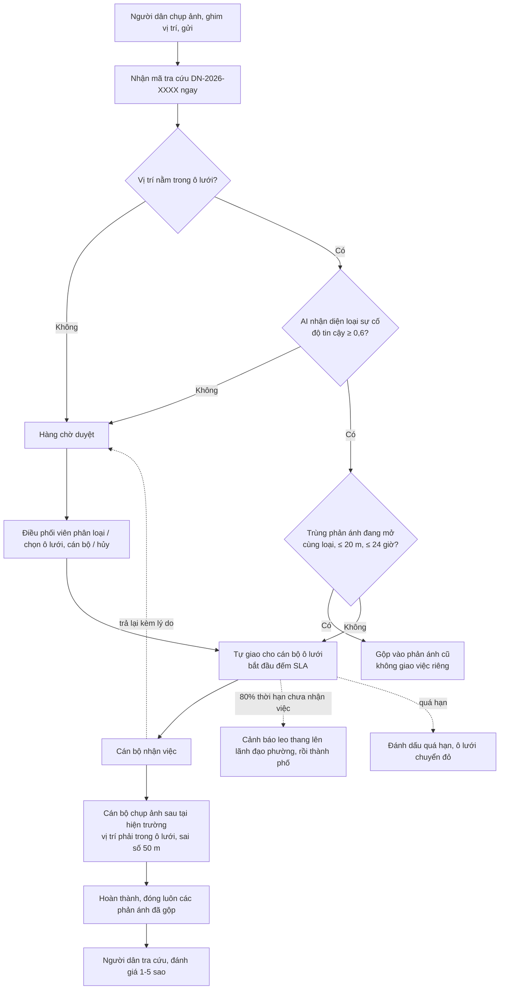

# Hướng dẫn kiểm thử – Đồng Nai GridSmart

Đọc mục 1 để chạy được, mục 2 để biết đăng nhập bằng tài khoản nào, mục 3 để hiểu hệ thống, mục 4 để kiểm thử từng luồng.

**GridSmart là gì:** người dân chụp ảnh sự cố đô thị (rác, lấn chiếm, hư hỏng hạ tầng, xả thải) và gửi lên. Hệ thống tự xác định ô lưới chứa vị trí, phân loại sự cố, giao cho cán bộ phụ trách ô lưới đó và đếm ngược thời hạn xử lý (SLA). Quá hạn mà chưa ai nhận thì báo lên lãnh đạo. Cán bộ xử lý xong phải chụp ảnh "sau" tại đúng hiện trường. Người dân tra cứu tiến độ.

---

## 1. Chạy hệ thống

### 1.1. Cần cài sẵn

| Phần mềm | Phiên bản | Ghi chú |
| :--- | :--- | :--- |
| SQL Server | 2017 trở lên | Instance mặc định, đăng nhập Windows, tài khoản có quyền tạo database |
| sqlcmd hoặc SSMS | bất kỳ | Để chạy file SQL |
| .NET SDK | 10 | Backend |
| Node.js | 20.19+ hoặc 22.12+ | Frontend (Vite 8) |
| Chrome hoặc Edge | mới | Cần DevTools để giả lập GPS (mục 4.2) |

Lần chạy đầu cần internet để tải gói NuGet và npm.

### 1.2. Ba bước

```powershell
# Bước 1. Tạo database và nạp dữ liệu test (chỉ chạy 1 lần)
sqlcmd -S "lpc:." -E -b -I -f 65001 -i database/dev_migration_full.sql
#   hoặc: mở file trong SSMS rồi bấm Execute (F5)

# Bước 2. Backend (terminal 1)
dotnet run --project backend/GridSmart.Api --launch-profile http
#   API: http://localhost:5282, tài liệu API: http://localhost:5282/scalar

# Bước 3. Frontend (terminal 2)
cd frontend
npm install
npm run dev
#   Mở http://localhost:5173
```

Kiểm tra nhanh: mở `http://localhost:5173/health`, phải thấy `"status":"Healthy"`.

### 1.3. Lỗi thường gặp khi cài

| Hiện tượng | Nguyên nhân | Cách xử lý |
| :--- | :--- | :--- |
| sqlcmd báo không kết nối được | SQL Server không phải instance mặc định (ví dụ SQL Express) | Dùng `-S ".\SQLEXPRESS"` và sửa `Server=` trong `backend/GridSmart.Api/appsettings.json` thành `Server=.\SQLEXPRESS;...` |
| File SQL báo "đã có dữ liệu, dừng lại" | Máy đã có database `dongnai_gridsmart` | Muốn nạp lại từ đầu: `DROP DATABASE dongnai_gridsmart;` rồi chạy lại. File không bao giờ ghi đè dữ liệu |
| Frontend mở được nhưng mọi thao tác báo lỗi mạng | Frontend gọi sai cổng backend | Xóa `frontend/.env.local` nếu có, chạy backend bằng profile `http` (cổng 5282). Trong Visual Studio chọn profile **http**, không chọn IIS Express |
| Phản ánh không có ảnh | Thiếu thư mục ảnh mẫu | Cần có `backend/GridSmart.Api/wwwroot/uploads/seed/`. Thiếu thì chạy `powershell -ExecutionPolicy Bypass -File database/tao_anh_mau.ps1` |
| Gửi phản ánh báo "thao tác quá nhanh" | Giới hạn 5 phản ánh mỗi 10 phút cho mỗi máy | Đợi 10 phút hoặc khởi động lại backend |

---

## 2. Tài khoản demo

Mật khẩu chung cho mọi tài khoản: **`GridSmart@2026`**

Đăng nhập tại `http://localhost:5173/login`. Sau khi đăng nhập, hệ thống tự chuyển tới khu vực phù hợp với vai trò.

| # | Tài khoản | Vai trò | Phạm vi | Vào khu vực | Dùng để kiểm thử |
| :- | :--- | :--- | :--- | :--- | :--- |
| 1 | `admin` | Quản trị hệ thống | Toàn hệ thống, mọi quyền | `/command` | Mọi màn hình, đặc biệt các màn hình quản trị: người dùng, vai trò, ô lưới, danh mục, SLA |
| 2 | `leader.tinh` | Lãnh đạo thành phố | Toàn TP Đồng Nai | `/command` | Bản đồ điều hành toàn thành phố, báo cáo, KPI cán bộ, nhận cảnh báo leo thang |
| 3 | `dispatcher01` | Điều phối viên | Toàn TP Đồng Nai | `/command` | Hàng chờ duyệt: phân loại, điều phối tay, giao lại, hủy |
| 4 | `leader.tb` / `leader.bh` | Lãnh đạo phường | Phường Trấn Biên / Phường Biên Hòa | `/command` | Phân quyền theo địa bàn: mỗi người **chỉ thấy sự cố trong phường mình**. `leader.tb` kiêm điều phối viên phường Trấn Biên |
| 5 | `officer01` | Cán bộ ô lưới | 3 khu phố (5 ô lưới) thuộc phường Trấn Biên | `/officer` | Nhận việc, xử lý, nghiệm thu bằng ảnh tại hiện trường, trả lại |

Người dân **không cần đăng nhập** để gửi phản ánh và tra cứu (mục 4.1, 4.3). Nếu muốn thử luồng công dân có tài khoản, dùng `citizen01` (cùng mật khẩu).

Dữ liệu có sẵn: 1 thành phố, 10 phường, 37 khu phố, 54 ô lưới (chỉ ở 3 phường thí điểm Trấn Biên, Biên Hòa, Tam Hiệp), 12 cán bộ, 40 phản ánh ở đủ trạng thái. Mốc thời gian của dữ liệu được dời theo lúc chạy file SQL, nên "3 ngày trước" vẫn là 3 ngày trước so với hôm nay.

---

## 3. Luồng hoạt động của hệ thống

### 3.1. Luồng tổng thể



Phần sau khi gửi (xác định ô lưới, AI, gộp trùng, giao việc) chạy nền, thường xong trong vài giây. Trang của cán bộ và trung tâm điều hành cập nhật tự động qua kết nối realtime.

### 3.2. Trạng thái phản ánh

| Trạng thái | Ý nghĩa | Bước tiếp theo |
| :--- | :--- | :--- |
| Mới | Vừa tiếp nhận hoặc đang chờ duyệt | Đã giao, Đã hủy |
| Đã giao | Đã có cán bộ, đang chờ cán bộ nhận | Đang xử lý, Đã hủy |
| Đang xử lý | Cán bộ đã nhận việc | Hoàn thành; hoặc trả lại về hàng chờ duyệt |
| Hoàn thành | Đã có ảnh nghiệm thu | Người dân đánh giá |
| Đã hủy | Spam, trùng, ngoài thẩm quyền | Kết thúc |

Ngoài trạng thái còn có các nhãn riêng: **Chờ duyệt**, **Quá hạn**, **Đã leo thang**.

### 3.3. AI phân loại (bản giả lập)

Bản đang chạy dùng AI giả lập: **phân loại theo từ khóa trong phần mô tả**, không nhìn ảnh. Ảnh nào cũng được, nhưng mô tả quyết định loại sự cố.

| Loại | Ưu tiên | SLA | Từ khóa ví dụ |
| :--- | :--- | :--- | :--- |
| Rác thải | Trung bình | 24 giờ | rác, rác thải, bãi rác, túi rác, xà bần, đổ rác |
| Lấn chiếm vỉa hè | Thấp | 48 giờ | lấn chiếm, vỉa hè, bán hàng rong, chợ tự phát, đậu xe |
| Hư hỏng hạ tầng | Khẩn cấp | 4 giờ | ổ gà, nắp cống, đèn đường, sụt lún, cây đổ, biển báo |
| Xả thải | Khẩn cấp | 4 giờ | xả thải, nước thải, mùi hôi, ô nhiễm, dầu nhớt |

* Mô tả khớp đúng **một** loại thì độ tin cậy 0,9 và tự giao việc.
* Khớp nhiều loại thì độ tin cậy 0,7, chọn loại khớp nhiều từ nhất.
* Không khớp từ nào thì độ tin cậy 0,3 và phản ánh **vào hàng chờ duyệt**, kể cả khi người dân đã tự chọn danh mục.

Danh sách từ khóa sửa được trong `appsettings.json`, mục `Ai:MockKeywords`.

### 3.4. Màu ô lưới trên bản đồ điều hành

| Màu | Ý nghĩa |
| :--- | :--- |
| Xanh | Không có sự cố đang mở |
| Vàng | Có sự cố đang mở, chưa quá hạn |
| Đỏ | Có sự cố quá hạn SLA |

---

## 4. Kịch bản kiểm thử

Nên mở **hai cửa sổ trình duyệt** (một cửa sổ thường, một cửa sổ ẩn danh) để đăng nhập hai vai trò cùng lúc và thấy cập nhật realtime.

### 4.1. Người dân gửi phản ánh, hệ thống tự giao cho officer01

Không cần đăng nhập.

1. Mở `http://localhost:5173`, bấm chọn ảnh. Ảnh bất kỳ, ví dụ `backend/GridSmart.Api/wwwroot/uploads/seed/waste_before.jpg`.
2. Ở bước xác nhận vị trí, **bấm lên bản đồ hoặc kéo ghim** tới Khu phố 1, phường Trấn Biên (ô lưới của officer01), quanh tọa độ `10.9645, 106.7975`. Màn hình hiện tên khu phố, phường.
   * Trình duyệt có thể tự lấy vị trí thật của bạn (không ở Biên Hòa), nên luôn kéo ghim lại.
3. Mô tả: `Có bãi rác tự phát, túi rác vứt bừa bãi ven đường`.
4. Số điện thoại: ví dụ `0912345678`. Bấm gửi.

**Kết quả mong đợi**
* Nhận ngay mã tra cứu dạng `DN-2026-XXXX`. Ghi lại mã này và số điện thoại.
* Sau vài giây, ở cửa sổ đăng nhập `officer01` (`/officer`, tab **Mới giao**) xuất hiện phản ánh mới, loại Rác thải, hạn SLA 24 giờ.
* Ở `admin` hoặc `leader.tb`, bản đồ điều hành có điểm mới, ô lưới chuyển vàng.

**Biến thể nên thử**

| Thử | Kết quả mong đợi |
| :--- | :--- |
| Gửi lần nữa, cách vị trí cũ dưới 20 m, mô tả cũng có "rác" | Không tạo việc mới, phản ánh được **gộp** vào phản ánh trước. Chi tiết phản ánh cũ có mục "Phản ánh gộp vào sự cố này" |
| Mô tả không có từ khóa, ví dụ `Có vật lạ ở đây` | Vào **hàng chờ duyệt**, lý do AI không nhận diện được |
| Ghim ở phường Long Bình, ví dụ `10.9530, 106.8780` | Vẫn nhận mã nhưng vào hàng chờ duyệt, lý do ngoài ô lưới (phường này chưa có ô lưới) |
| Mô tả có `ổ gà` hoặc `nắp cống` | Loại Hư hỏng hạ tầng, khẩn cấp, SLA 4 giờ |

### 4.2. Cán bộ ô lưới xử lý: `officer01`

1. Đăng nhập `officer01`, hệ thống mở `/officer`. Có 3 tab: **Mới giao**, **Đang xử lý**, **Đã xong (7 ngày)**.
2. Tab **Mới giao** có sẵn phản ánh **DN-2026-Z7KC** (nước thải, nhãn **Quá hạn**), cùng phản ánh vừa gửi ở mục 4.1 nếu có.
3. Mở phản ánh, bấm **Nhận việc**. Phản ánh chuyển sang tab **Đang xử lý**.
4. **Giả lập vị trí hiện trường** (bắt buộc khi test trên máy tính):
   * Mở DevTools (`F12`), bấm `Ctrl+Shift+P`, gõ `Sensors`, chọn **Show Sensors**.
   * Mục **Location** chọn **Other…**, nhập tọa độ của phản ánh. Với DN-2026-Z7KC: Latitude `10.9665`, Longitude `106.7985`. Với phản ánh mục 4.1: tọa độ đã ghim.
   * Cho phép trang dùng vị trí khi trình duyệt hỏi, rồi tải lại trang.
5. Trong khung **Báo đã xử lý**: chọn ảnh "sau" (ví dụ `waste_after.jpg`), ghi chú tùy ý, bấm **Gửi nghiệm thu**.

**Kết quả mong đợi**
* Phản ánh chuyển **Hoàn thành**, sang tab **Đã xong**. Các phản ánh đã gộp vào nó cũng được đóng.
* Bản đồ điều hành: ô lưới đổi màu nếu không còn sự cố mở.

**Biến thể nên thử**

| Thử | Kết quả mong đợi |
| :--- | :--- |
| Để vị trí giả lập xa hiện trường (ví dụ giữ vị trí thật của bạn) rồi gửi nghiệm thu | Màn hình cảnh báo nằm ngoài ô lưới; nếu vẫn gửi, server từ chối vì ảnh không chụp tại hiện trường |
| Ở phản ánh đang xử lý, bấm **Trả lại** và nhập lý do | Phản ánh rời danh sách của cán bộ, vào **hàng chờ duyệt** của điều phối viên |
| Truy cập `http://localhost:5173/command` | Trang 403, vì cán bộ không có quyền vào trung tâm điều hành |

### 4.3. Người dân tra cứu và đánh giá

Không cần đăng nhập.

1. Mở `http://localhost:5173/track`.
2. Nhập mã và số điện thoại đã gửi ở mục 4.1. Hoặc dùng dữ liệu có sẵn:

| Mã | Số điện thoại | Trạng thái |
| :--- | :--- | :--- |
| DN-2026-M4GZ | 0965321789 | Hoàn thành, **chưa đánh giá**: dùng để thử đánh giá |
| DN-2026-Q5HS | 0908123123 | Hoàn thành, chưa đánh giá |
| DN-2026-Z7KC | 0905558899 | Đã giao, quá hạn (hoặc Hoàn thành nếu đã làm mục 4.2) |
| DN-2026-T2LG | 0938765432 | Phản ánh đã được gộp: hiển thị tiến độ của phản ánh gốc DN-2026-T9LF |

**Kết quả mong đợi**
* Thấy tiến trình xử lý, ảnh trước và sau, nhật ký công khai.
* Phản ánh hoàn thành có form đánh giá 1–5 sao. Mỗi phản ánh chỉ đánh giá được một lần. Phản ánh chưa xong thì không có form.
* Sai số điện thoại thì không xem được chi tiết.

### 4.4. Điều phối viên xử lý hàng chờ duyệt: `dispatcher01`

1. Đăng nhập `dispatcher01`. Menu trái có **Hàng chờ duyệt** kèm số đếm. Mở `/command/review`.
2. Dữ liệu có sẵn 5 phản ánh chờ duyệt, mỗi cái một lý do:

| Mã | Ở đâu | Lý do chờ duyệt | Nên thử |
| :--- | :--- | :--- | :--- |
| DN-2026-M6QS | Trấn Biên, KP6 | AI không chắc chắn (0,41) | **Phân loại** chọn danh mục, rồi **Điều phối** |
| DN-2026-R3BX | Tam Hiệp, KP4 | AI không chắc chắn (0,52) | Phân loại là Hư hỏng hạ tầng |
| DN-2026-K8TD | Trảng Dài | Ngoài ô lưới | **Điều phối**: chọn ô lưới hoặc cán bộ phụ trách |
| DN-2026-H5NC | Long Bình | Ngoài ô lưới | Điều phối tay |
| DN-2026-P9WE | Long Hưng | Ngoài ô lưới | **Hủy** kèm lý do |

3. Ở màn **Sự cố** (`/command/incidents`), mở một phản ánh đang giao, thử **Giao lại** cho cán bộ khác. Danh sách cán bộ hiển thị số việc đang mở của từng người.

**Kết quả mong đợi**
* Phân loại xong và đã có ô lưới thì phản ánh tự giao việc và rời hàng chờ.
* Điều phối tay thì cán bộ được chọn thấy việc mới ngay ở `/officer`.
* Hủy thì phản ánh chuyển **Đã hủy**, người dân tra cứu thấy lý do.
* Mọi thao tác ghi vào **Nhật ký xử lý** ở trang chi tiết.

### 4.5. Lãnh đạo phường: phân quyền theo địa bàn, `leader.tb` và `leader.bh`

1. Đăng nhập `leader.tb`. Bản đồ điều hành chỉ có ô lưới, sự cố của **phường Trấn Biên**. Danh sách **Sự cố** chỉ có sự cố Trấn Biên.
2. Đăng xuất, đăng nhập `leader.bh`: chỉ thấy **phường Biên Hòa**.
3. Thử vượt phạm vi: khi đăng nhập `leader.bh`, mở trực tiếp một sự cố của Trấn Biên bằng đường dẫn `/command/incidents/<id>` (lấy id từ tài khoản `leader.tb`). Kết quả mong đợi: bị từ chối.
4. `leader.tb` kiêm điều phối viên Trấn Biên, nên thấy **Hàng chờ duyệt**, nhưng **chỉ có DN-2026-M6QS** (của Trấn Biên). `leader.bh` không có mục này.
5. Chuông thông báo: lãnh đạo nhận cảnh báo **leo thang** khi sự cố trong phường quá 80% thời hạn mà cán bộ chưa nhận việc. Dữ liệu mẫu đã có sẵn vài cảnh báo.
6. Mục **Báo cáo**: thống kê theo khu phố, theo loại sự cố, KPI cán bộ, xuất Excel. Tất cả chỉ trong phường mình.

### 4.6. Lãnh đạo thành phố: `leader.tinh`

1. Bản đồ điều hành toàn thành phố: lớp ô lưới theo màu xanh/vàng/đỏ, lớp bản đồ nhiệt (heatmap) điểm nóng.
2. Ô chọn phạm vi ở thanh trên: xem toàn thành phố hoặc từng phường.
3. **Báo cáo**: so sánh các phường, xu hướng theo ngày, KPI từng cán bộ (thời gian nhận việc, thời gian xử lý, tỷ lệ đúng hạn, điểm đánh giá, số lần leo thang), xuất Excel.
4. Nhận cảnh báo leo thang khi cấp phường không có ai nhận.
5. Không có mục **Hàng chờ duyệt** và không có nút điều phối (lãnh đạo chỉ được giao lại).

### 4.7. Quản trị hệ thống: `admin`

Ngoài mọi màn hình trên, `admin` có nhóm **Quản trị**:

| Màn hình | Nên thử |
| :--- | :--- |
| Người dùng | Tạo cán bộ mới; gán vai trò `GRID_OFFICER` tại một khu phố; khóa, mở khóa tài khoản; đặt lại mật khẩu |
| Vai trò và quyền | Xem ma trận vai trò–quyền; bỏ một quyền của vai trò rồi đăng nhập lại tài khoản thuộc vai trò đó để thấy menu thay đổi |
| Ô lưới | Vẽ ô lưới mới trên bản đồ; phân công cán bộ chính cho ô lưới |
| Đơn vị hành chính | Cây thành phố → phường → khu phố; thử sáp nhập |
| Danh mục | Thêm, tắt danh mục sự cố |
| SLA | Đổi số giờ SLA và ngưỡng cảnh báo (mặc định 80%) |

Gợi ý kiểm thử trọn vòng: tạo cán bộ mới, gán vào một ô lưới chưa có ai, gửi phản ánh vào ô lưới đó (mục 4.1), rồi đăng nhập cán bộ mới để xử lý.

### 4.8. Realtime và SLA chạy nền

* Mở `officer01` ở một cửa sổ, `admin` ở cửa sổ kia, rồi gửi phản ánh (mục 4.1). Cả hai màn hình cập nhật mà không cần tải lại. Huy hiệu trạng thái kết nối ở góc màn hình.
* SLA engine quét mỗi 60 giây:
  * Quá 80% thời hạn mà chưa nhận việc: báo lên lãnh đạo phường, gắn nhãn **Đã leo thang**.
  * Quá hạn: gắn nhãn **Quá hạn**, ô lưới chuyển đỏ.
* Muốn thấy nhanh: gửi phản ánh loại khẩn cấp (mô tả có `ổ gà`), SLA 4 giờ, cảnh báo ở mốc khoảng 3 giờ 12 phút. Hoặc tạm đổi SLA khẩn cấp xuống 1 giờ ở màn **SLA** (tài khoản `admin`).

---

## 5. Ghi chú

* Tài khoản `officer03` đang bị khóa trong dữ liệu mẫu (do thử chức năng khóa). Mở khóa ở màn **Người dùng** nếu cần.
* Sai mật khẩu 5 lần liên tiếp thì tài khoản bị khóa tạm 15 phút.
* Phiên đăng nhập 15 phút, tự gia hạn khi đang dùng.
* Ranh giới phường, khu phố là **gần đúng**, tên khu phố là minh họa. Chưa phải bản đồ địa chính.
* Muốn đưa database về trạng thái ban đầu: `DROP DATABASE dongnai_gridsmart;` rồi chạy lại `database/dev_migration_full.sql`.
* Tài liệu kỹ thuật chi tiết: `docs/flow-he-thong.md` (luồng nghiệp vụ), `docs/kien-truc-he-thong.md` (kiến trúc), `database/README.md` (database).
